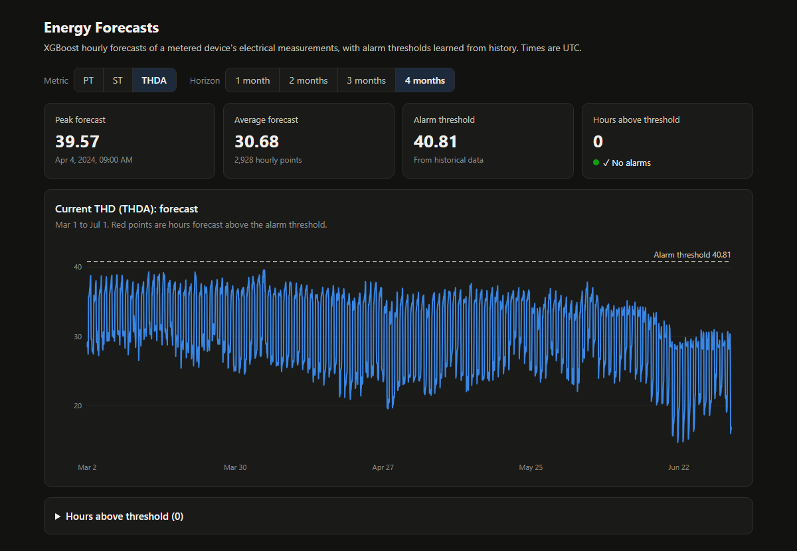
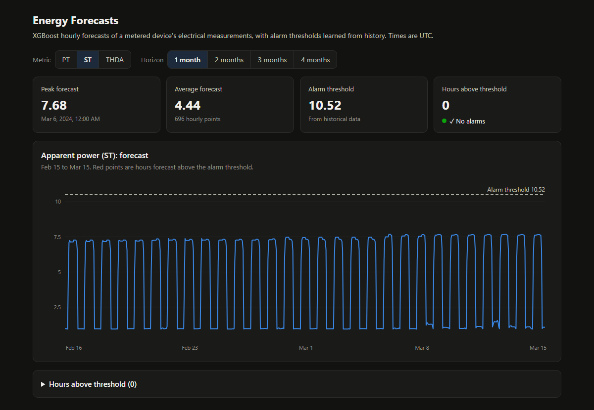

# xgboost-forecasting

Hourly forecasts of electrical measurements from an industrial power meter, served by a FastAPI backend with a built-in web dashboard. Each metric has its own XGBoost model trained on calendar features, plus an alarm threshold learned from historical data, so the dashboard can flag the hours where the forecast exceeds it.

| Metric | What it is | Data source |
|---|---|---|
| **PT** | Active power | Live InfluxDB query (last 12 months) |
| **ST** | Apparent power | InfluxDB CSV export |
| **THDA** | Current total harmonic distortion | InfluxDB CSV export |

## Demo

> The measurement data belongs to a client and is not included in this repository. The screenshots below were taken from a local run on the real data.





The dashboard shows:

- the peak and average forecast, the alarm threshold, and how many hours are forecast above it
- the hourly forecast line with the threshold, with alarm hours marked in red (hover for exact values)
- a table of every hour above the threshold

## How it works

For each request the API:

1. loads the history (InfluxDB for PT, CSV for ST and THDA) and removes outliers
2. computes the alarm threshold: the mean of values above a cutoff, plus a margin (PT: >4, +10%; ST: >4, +20%; THDA: >35, +10%)
3. builds calendar features: day of year, hour, weekday, month, quarter, year, and day/night (THDA uses season-dependent daylight hours)
4. loads the saved model, training it once on the GPU if no model file exists yet
5. predicts every hour from the last reading up to 1–4 months ahead and marks the alarm hours

## Running locally

Requires Python 3.9+ and, for training, an NVIDIA GPU (models train with `device='cuda'`).

```sh
python -m venv .venv
.venv/Scripts/activate        # Windows; use .venv/bin/activate on macOS/Linux
pip install -r requirements.txt
uvicorn main:app --reload
```

Open <http://localhost:8000/>.

**Data:** put the InfluxDB CSV exports at `routes/st.csv` and `routes/thda.csv`. They are git-ignored.

**PT:** needs a reachable InfluxDB 2.x with the measurement in a bucket named `Predictions`:

```sh
export INFLUXDB_TOKEN=...                    # required
export INFLUXDB_URL=http://localhost:8086    # default
export INFLUXDB_ORG=project                  # default
```

The first request for each metric trains its model (seconds for ST, longer for THDA) and saves it as `xgboost<METRIC>_model.pkl`. Later requests reuse it. To retrain, delete the file.

## API

All endpoints are `GET` and take `months` (1–4, default 1).

| Endpoint | Response |
|---|---|
| `/getPTPredictions` | `{"PTPredictions": [...], "threshold": float}` |
| `/getSTPredictions` | `{"STPredictions": [...], "STthreshold": float}` |
| `/getTHDAPredictions` | `{"THDAPredictions": [...], "THDAthreshold": float}` |

Each prediction is `{"date": "YYYY-MM-DD HH:MM:SS", "prediction": float, "alarm": bool, "threshold": float}`, with times in UTC. Interactive docs are at `/docs`.

## Project layout

```text
main.py              FastAPI app; serves the dashboard from static/
routes/route.py      the three forecast endpoints
Tools/               one forecaster class per metric (load, features, train, forecast)
static/index.html    the dashboard (plain HTML/JS, no build step)
main3.py–main6.py    standalone modelling experiments (multi-target, lag features, CV)
```
